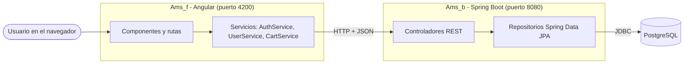
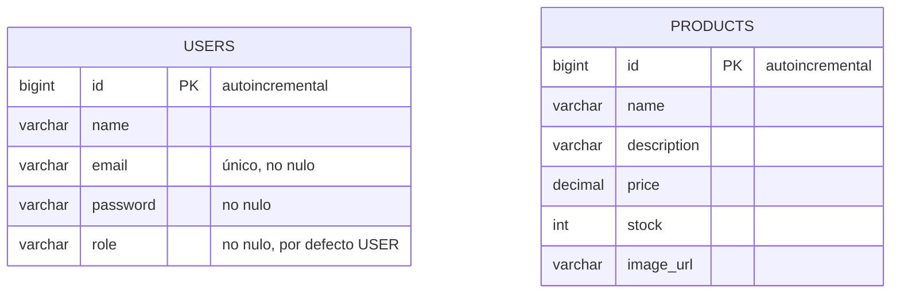
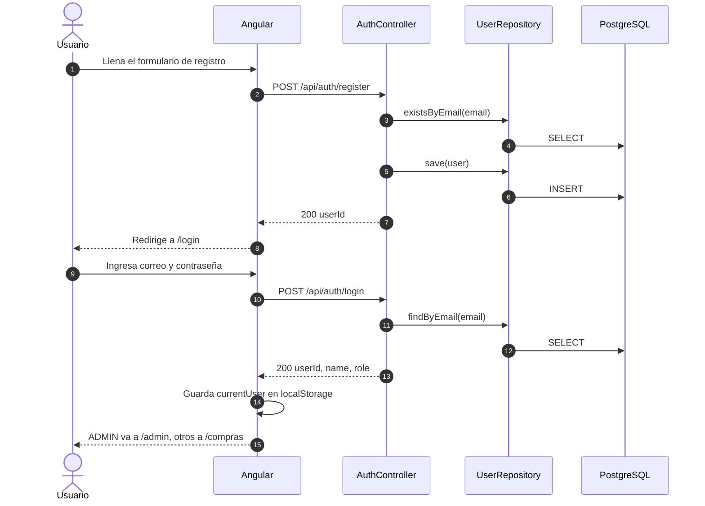
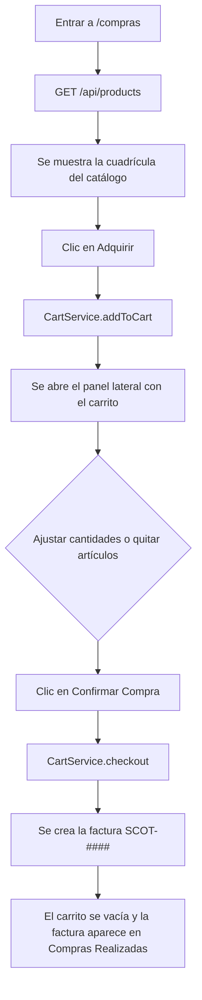
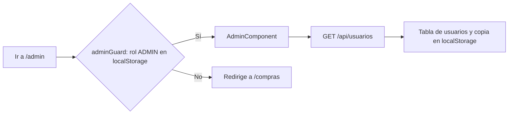

<div align="center">

# Ams

### Sistema de compra online con catálogo, carrito y panel de administración

*Calidad y confianza en cada transacción.*


**Backend REST con Spring Boot** y **frontend SPA con Angular**, en un solo repositorio.

</div>

---

## Contenido

1. [Qué es Ams](#qué-es-ams)
2. [Características](#características)
3. [Tecnologías](#tecnologías)
4. [Arquitectura general](#arquitectura-general)
5. [Estructura del repositorio](#estructura-del-repositorio)
6. [Modelo de datos](#modelo-de-datos)
7. [Backend en detalle](#backend-en-detalle)
8. [Referencia de la API](#referencia-de-la-api)
9. [Frontend en detalle](#frontend-en-detalle)
10. [Flujos principales](#flujos-principales)
11. [Puesta en marcha](#puesta-en-marcha)
12. [Configuración](#configuración)
13. [Roles y cuenta de administrador](#roles-y-cuenta-de-administrador)
14. [Pruebas](#pruebas)
15. [Estado actual y límites conocidos](#estado-actual-y-límites-conocidos)
16. [Hoja de ruta](#hoja-de-ruta)
17. [Solución de problemas](#solución-de-problemas)
18. [Autor](#autor)

---

## Qué es Ams

Ams es una tienda en línea dividida en dos aplicaciones que se comunican por HTTP. El **backend** (`Ams_b`) es una API REST hecha con Spring Boot que guarda usuarios y productos en PostgreSQL. El **frontend** (`Ams_f`) es una aplicación de una sola página hecha con Angular que muestra el catálogo, deja armar un carrito, registra e inicia sesión de usuarios y ofrece un panel para administradores.

El nombre de marca que se ve en la interfaz es **Ams**, con el lema *Sistema de Compra Online: calidad y confianza en cada transacción*.

---

## Características

**Para el cliente**

- Catálogo de productos cargado desde el backend, con imagen, nombre y precio.
- Carrusel de banners de cuatro diapositivas con avance automático cada 7 segundos, flechas y puntos de navegación.
- Carrito de compras: agregar productos, cambiar cantidades, quitar artículos y ver items y total.
- Confirmación de compra con generación de una factura (`SCOT-####`) y historial de compras realizadas.
- Panel lateral deslizable que reúne el carrito y el historial.
- Registro con validación de formulario (nombre, correo válido, contraseña de mínimo 6 caracteres y confirmación).
- Inicio de sesión y menú de perfil con avatar, nombre, correo y botón para cerrar sesión.

**Para el administrador**

- Ruta `/admin` protegida por un guard que solo deja pasar a usuarios con rol `ADMIN`.
- Tarjetas de indicadores (ingresos, usuarios y ventas).
- Gráfico de líneas con Chart.js.
- Tabla de usuarios registrados (ID, nombre, correo y rol) obtenida del backend, con copia local para no quedar en blanco si el servidor falla.
- Barra lateral con visualizador de audio animado y una animación Lottie.

**Para el desarrollador**

- Backend mínimo y legible: cuatro endpoints, dos entidades y dos repositorios.
- Tablas generadas automáticamente por Hibernate (`ddl-auto=update`).
- CORS ya configurado para el servidor de desarrollo de Angular.

---

## Tecnologías

| Capa | Tecnología | Versión / detalle |
| :--- | :--- | :--- |
| Backend | Spring Boot (`starter-webmvc`) | 4.0.6 |
| Backend | Spring Data JPA + Hibernate | Dialecto PostgreSQL, `ddl-auto=update` |
| Backend | Lombok | `@Data` en las entidades |
| Backend | Base de datos | PostgreSQL (driver en `runtime`) |
| Backend | Construcción | Maven (wrapper `mvnw` / `mvnw.cmd` incluido) |
| Backend | Pruebas | JUnit 5 con `spring-boot-starter-*-test` |
| Frontend | Angular | 21.2 (componentes standalone, señales, bloques `@if` / `@for`) |
| Frontend | TypeScript | 5.9 |
| Frontend | RxJS | 7.8 |
| Frontend | Chart.js | 4.5 |
| Frontend | ngx-lottie + lottie-web | Animación del panel de administración |
| Frontend | Pruebas | Vitest 4 con jsdom |
| Frontend | Formato | Prettier |

---

## Arquitectura general



El frontend nunca habla con la base de datos: todo pasa por la API. El estado del carrito y del historial de compras vive hoy en el navegador (señales de Angular), mientras que usuarios y productos viven en PostgreSQL.

---

## Estructura del repositorio

```text
Ams
├── Ams_b                                   # Backend (Spring Boot, Maven)
│   ├── pom.xml
│   ├── mvnw / mvnw.cmd
│   └── src
│       ├── main
│       │   ├── java/com/ams/ecom
│       │   │   ├── AmsApplication.java     # Punto de entrada
│       │   │   ├── config
│       │   │   │   └── WebConfig.java      # CORS para http://localhost:4200
│       │   │   ├── controller
│       │   │   │   ├── AuthController.java     # Registro e inicio de sesión
│       │   │   │   ├── ProductController.java  # Listado de productos
│       │   │   │   └── UserController.java     # Listado de usuarios
│       │   │   ├── model
│       │   │   │   ├── Product.java        # Entidad JPA "products"
│       │   │   │   └── User.java           # Entidad JPA "users"
│       │   │   └── repository
│       │   │       ├── ProductRepository.java
│       │   │       └── UserRepository.java
│       │   └── resources/application.properties
│       └── test/java/com/ams/ecom/AmsApplicationTests.java
│
└── Ams_f                                   # Frontend (Angular 21)
    ├── angular.json / package.json
    ├── public
    │   ├── favicon.ico
    │   └── animacion.json                  # Animación Lottie del panel admin
    └── src
        ├── index.html / main.ts / styles.scss
        ├── assets/img/github.png
        └── app
            ├── app.ts / app.html / app.config.ts / app.routes.ts
            ├── Admin/                      # Panel de administración
            ├── Page
            │   ├── Compras/                # Tienda: navbar, carrusel, catálogo
            │   ├── Carrito/                # Carrito de compras
            │   ├── historial-compras/      # Compras realizadas
            │   ├── login/                  # Inicio de sesión
            │   └── Register/               # Registro
            └── Service
                ├── auth.service.ts         # Login, logout, isAdmin, isLoggedIn
                ├── user.service.ts         # Usuario actual y carga de usuarios
                ├── cart.service.ts         # Carrito e historial (señales)
                └── admin.guard.ts          # Protege la ruta /admin
```

---

## Modelo de datos

Hibernate crea las dos tablas al arrancar el backend por primera vez.



| Tabla | Columna | Notas |
| :--- | :--- | :--- |
| `users` | `id` | Clave primaria con `GenerationType.IDENTITY` |
| `users` | `email` | `unique = true`, `nullable = false` |
| `users` | `password` | `nullable = false` |
| `users` | `role` | Vale `USER` si no se indica; el administrador usa `ADMIN` |
| `products` | `price` | `BigDecimal` |
| `products` | `stock` | `Integer` |
| `products` | `image_url` | Se serializa como `imageUrl` en el JSON |

Por ahora no existen tablas de pedidos ni de detalle de compra: las compras se registran solo en el navegador (ver [límites conocidos](#estado-actual-y-límites-conocidos)).

---

## Backend en detalle

El paquete base es `com.ams.ecom` y sigue la organización clásica por capas de Spring:

- **`model`**: `User` y `Product`, entidades JPA con Lombok `@Data` (getters, setters, `equals`, `hashCode` y `toString` generados).
- **`repository`**: interfaces que extienden `JpaRepository`. `UserRepository` agrega `findByEmail` y `existsByEmail`; `ProductRepository` usa solo los métodos heredados.
- **`controller`**: tres controladores REST bajo `/api`, todos con `@CrossOrigin` hacia `http://localhost:4200`.
- **`config`**: `WebConfig` registra CORS para todas las rutas, con los métodos `GET`, `POST`, `PUT`, `DELETE` y `OPTIONS`, cualquier cabecera y credenciales permitidas.

El servidor arranca por defecto en el puerto **8080**, que es el que usa el frontend en todas sus llamadas.

---

## Referencia de la API

URL base: `http://localhost:8080`. Todo el intercambio es JSON.

| Método | Endpoint | Descripción | Respuestas |
| :---: | :--- | :--- | :---: |
| `POST` | `/api/auth/register` | Registrar un usuario | `200`, `400` |
| `POST` | `/api/auth/login` | Iniciar sesión | `200`, `401` |
| `GET` | `/api/usuarios` | Listar todos los usuarios | `200` |
| `GET` | `/api/products` | Listar todos los productos | `200` |

### POST `/api/auth/register`

Cuerpo de la petición:

```json
{
  "name": "Michel",
  "email": "michel@ams.com",
  "password": "secreto123"
}
```

Respuesta `200 OK`:

```json
{
  "message": "Usuario registrado con éxito",
  "userId": 1
}
```

Si el correo ya existe responde `400 Bad Request`:

```json
{
  "message": "Error: El correo electrónico ya está registrado."
}
```

El formulario del frontend también envía `confirmPassword`, que el backend simplemente ignora: la comparación de contraseñas se hace en el navegador.

### POST `/api/auth/login`

Cuerpo de la petición:

```json
{
  "email": "michel@ams.com",
  "password": "secreto123"
}
```

Respuesta `200 OK`:

```json
{
  "message": "Login exitoso",
  "userId": 1,
  "name": "Michel",
  "role": "USER"
}
```

Si el correo no existe o la contraseña no coincide responde `401 Unauthorized`:

```json
{
  "message": "Error: Credenciales incorrectas."
}
```

### GET `/api/products`

Devuelve un arreglo con todos los productos. Cada elemento tiene esta forma:

```json
{
  "id": 1,
  "name": "Producto de ejemplo",
  "description": "Descripción del producto",
  "price": 49.99,
  "stock": 10,
  "imageUrl": "https://ejemplo.com/imagen.png"
}
```

### GET `/api/usuarios`

Devuelve un arreglo con todos los usuarios. Lo consume el panel de administración para llenar su tabla.

---

## Frontend en detalle

### Rutas

| Ruta | Componente | Acceso |
| :--- | :--- | :--- |
| `/` y `/compras` | `ComprasComponent` | Público |
| `/login` | `LoginComponent` | Público |
| `/register` | `RegisterComponent` | Público |
| `/admin` | `AdminComponent` (carga diferida) | Solo `ADMIN`, protegida por `adminGuard` |
| cualquier otra | Redirige a `/` | |

### Servicios

| Servicio | Responsabilidad |
| :--- | :--- |
| `AuthService` | Llama a `POST /api/auth/login`, guarda la respuesta en `localStorage` bajo la clave `currentUser` y expone `logout()`, `isAdmin()` e `isLoggedIn()`. |
| `UserService` | Mantiene el usuario actual como `BehaviorSubject` (`currentUser$`), carga la lista de usuarios desde `GET /api/usuarios` y cierra sesión. |
| `CartService` | Guarda el carrito y las órdenes en señales de Angular. Calcula `cartTotal` y `cartCount` como señales derivadas y ofrece `addToCart`, `removeFromCart`, `updateQuantity` y `checkout`. |
| `adminGuard` | Si `isAdmin()` es falso redirige a `/compras`. |

### Componentes

- **`ComprasComponent`**: barra de navegación con botón de menú, logo, buscador y acceso o menú de perfil; carrusel; panel lateral; cuadrícula de productos con botón **Adquirir**; sección informativa; pie de página y botón flotante de atención al cliente.
- **`CarritoComponent`**: lista de artículos con campo de cantidad y botón de eliminar, total y botón **Confirmar Compra**.
- **`HistorialComprasComponent`**: lista de facturas con hora, artículos y total pagado.
- **`LoginComponent`** y **`RegisterComponent`**: formularios reactivos con validación. Tras iniciar sesión, un `ADMIN` va a `/admin` y cualquier otro usuario a `/compras`.
- **`AdminComponent`**: indicadores, gráfico, tabla de usuarios, animación Lottie y barra lateral.

---

## Flujos principales

### Registro e inicio de sesión



### Compra en la tienda



### Acceso al panel de administración



---

## Puesta en marcha

### Requisitos

| Herramienta | Versión |
| :--- | :--- |
| JDK | 17 o superior (Spring Boot 4 lo exige) |
| Node.js | 20.19 o superior (requisito de Angular 21) |
| npm | Incluido con Node.js (también hay `pnpm-lock.yaml` si prefieres pnpm) |
| PostgreSQL | Una instancia accesible y una base de datos vacía |

Maven no hace falta: el repositorio trae el wrapper.

### 1. Clonar el repositorio

```bash
git clone https://github.com/MichEverest/Ams.git
cd Ams
```

### 2. Preparar la base de datos

Crea una base de datos vacía en PostgreSQL, por ejemplo llamada `ams`:

```sql
CREATE DATABASE ams;
```

No necesitas crear las tablas: Hibernate las genera al arrancar.

### 3. Configurar el backend

Abre `Ams_b/src/main/resources/application.properties` y completa la URL, el usuario y la contraseña de tu base de datos:

```properties
spring.datasource.url=jdbc:postgresql://localhost:5432/ams
spring.datasource.username=postgres
spring.datasource.password=tu_contraseña
spring.datasource.driver-class-name=org.postgresql.Driver

spring.jpa.database-platform=org.hibernate.dialect.PostgreSQLDialect
spring.jpa.hibernate.ddl-auto=update
spring.jpa.show-sql=true
```

### 4. Ejecutar el backend

```bash
cd Ams_b
./mvnw spring-boot:run
```

En Windows usa `mvnw.cmd spring-boot:run`. Cuando veas que Spring terminó de arrancar, la API queda en `http://localhost:8080`.

### 5. Ejecutar el frontend

En otra terminal:

```bash
cd Ams_f
npm install
npm start
```

Abre **http://localhost:4200**. La aplicación se recarga sola cuando cambias un archivo.

### 6. Cargar productos de ejemplo

El backend aún no tiene un endpoint para crear productos, así que el catálogo se llena directamente en la base de datos. Conéctate a PostgreSQL y ejecuta, por ejemplo:

```sql
INSERT INTO products (name, description, price, stock, image_url) VALUES
  ('Producto uno',  'Descripción del primer producto',  49.99, 20, 'https://ejemplo.com/uno.png'),
  ('Producto dos',  'Descripción del segundo producto', 25.00, 50, 'https://ejemplo.com/dos.png'),
  ('Producto tres', 'Descripción del tercer producto',  99.90, 10, 'https://ejemplo.com/tres.png');
```

Recarga la tienda y los productos aparecerán en la cuadrícula.

### Comandos útiles

| Dónde | Comando | Qué hace |
| :--- | :--- | :--- |
| `Ams_b` | `./mvnw spring-boot:run` | Inicia el backend |
| `Ams_b` | `./mvnw clean test` | Compila y corre las pruebas |
| `Ams_b` | `./mvnw clean package` | Genera el `.jar` en `target/` |
| `Ams_f` | `npm start` | Servidor de desarrollo en el puerto 4200 |
| `Ams_f` | `npm run build` | Compilación de producción en `dist/` |
| `Ams_f` | `npm run watch` | Compila en modo desarrollo y vigila cambios |
| `Ams_f` | `npm test` | Pruebas unitarias con Vitest |

---

## Configuración

| Qué | Dónde | Valor actual |
| :--- | :--- | :--- |
| Conexión a la base de datos | `Ams_b/src/main/resources/application.properties` | Vacío: hay que completarlo |
| Creación de tablas | `spring.jpa.hibernate.ddl-auto` | `update` |
| SQL en consola | `spring.jpa.show-sql` | `true` |
| Puerto del backend | Por defecto de Spring Boot (`server.port`) | `8080` |
| Origen permitido por CORS | `WebConfig.java` y `@CrossOrigin` en cada controlador | `http://localhost:4200` |
| URL del backend en el frontend | `auth.service.ts`, `user.service.ts`, `compras.component.ts`, `registro.component.ts`, `admin.component.ts` | `http://localhost:8080` |
| Sesión del usuario | `localStorage`, clave `currentUser` | Respuesta del login |
| Caché de usuarios del admin | `localStorage`, clave `usuarios_cache` | Última lista recibida |

Si cambias el puerto del backend o publicas el frontend en otro dominio, actualiza tanto el CORS del backend como las URL de esos cinco archivos del frontend.

---

## Roles y cuenta de administrador

Existen dos roles: `USER`, que se asigna por defecto al registrarse, y `ADMIN`, que habilita el panel `/admin`. La aplicación no tiene una pantalla para crear administradores, así que se promueve a un usuario directamente en la base de datos:

1. Regístrate desde `http://localhost:4200/register`.
2. Ejecuta en PostgreSQL:

```sql
UPDATE users SET role = 'ADMIN' WHERE email = 'michel@ams.com';
```

3. Inicia sesión de nuevo. El login te llevará directo a `/admin`.

---

## Pruebas

| Proyecto | Qué hay | Cómo correrlo |
| :--- | :--- | :--- |
| Backend | `AmsApplicationTests.contextLoads()`, una prueba que verifica que el contexto de Spring arranca. Como carga la aplicación completa, necesita que la conexión a PostgreSQL esté configurada. | `./mvnw clean test` |
| Frontend | `app.spec.ts`, generado por Angular CLI, con Vitest y jsdom. | `npm test` |

La cobertura de pruebas es mínima por ahora; ampliarla aparece en la [hoja de ruta](#hoja-de-ruta).

---

## Estado actual y límites conocidos

Ams está en desarrollo. Esta sección lista con honestidad lo que ya funciona y lo que todavía es provisional, para que nadie se lleve sorpresas.

**Ya funciona de punta a punta**

- Registro e inicio de sesión contra PostgreSQL.
- Catálogo de productos servido por el backend.
- Carrito, confirmación de compra e historial dentro de la sesión del navegador.
- Listado de usuarios en el panel de administración, con guard por rol.

**Provisional o pendiente**

- **Las compras no se guardan en el servidor.** El carrito, las facturas `SCOT-####` y el historial viven en memoria del navegador y se pierden al recargar la página.
- **No hay endpoints para crear, editar o borrar productos.** El catálogo se administra por SQL.
- **Las contraseñas se guardan y se comparan en texto plano.** Falta aplicar un hash (por ejemplo, BCrypt con Spring Security).
- **`GET /api/usuarios` devuelve la entidad completa**, incluido el campo `password`. Conviene responder con un DTO sin esa información.
- **El registro acepta el campo `role` del cuerpo de la petición.** Debería fijarse siempre en `USER` en el servidor.
- **El guard del frontend no es seguridad real.** Solo oculta la ruta; la API no valida sesión ni rol. Hace falta autenticación en el backend (por ejemplo, tokens JWT).
- **Los indicadores del panel admin son parciales.** Ingresos y ventas están en 0 y el gráfico semanal usa datos de ejemplo; solo el contador de usuarios es real.
- **El menú de perfil muestra campos que el backend aún no envía.** `saldo`, `totalCompras` y `fotoUrl` toman valores por defecto, y el login no devuelve el correo.
- **El buscador de la barra superior y el botón de atención al cliente (`/soporte`) todavía no hacen nada.**
- **El `pom.xml` declara `java.version` 11**, pero Spring Boot 4 requiere Java 17 o superior; conviene actualizarlo a 17.
- **Las URL del backend están escritas a mano** en cinco archivos del frontend; lo ideal es centralizarlas en un archivo de entorno.
- **`app.componet.ts` contiene un `NavbarComponent` que no se usa** en ninguna parte.

---

## Hoja de ruta

- [ ] Guardar pedidos en la base de datos (tablas de orden y detalle) y conectarlos al historial.
- [ ] CRUD de productos para administradores en la API y en el panel.
- [ ] Contraseñas con hash y autenticación por token (Spring Security + JWT).
- [ ] DTOs de entrada y salida, y validación con `@Valid`.
- [ ] Manejo global de errores con respuestas uniformes.
- [ ] Indicadores reales en el panel: ingresos, ventas y gráfico calculados desde los pedidos.
- [ ] Control de stock al confirmar una compra.
- [ ] Buscador de productos y página de soporte.
- [ ] Archivo de entorno y servicio HTTP único en el frontend.
- [ ] Pruebas de controladores, repositorios, servicios y componentes.
- [ ] Contenedores con Docker Compose (PostgreSQL, backend y frontend).

---

## Solución de problemas

| Síntoma | Causa probable | Qué hacer |
| :--- | :--- | :--- |
| El backend falla al iniciar con un error de URL o de conexión | `application.properties` sigue con la URL, usuario y contraseña vacíos | Completa los tres valores y comprueba que PostgreSQL esté encendido |
| `password authentication failed` | Usuario o contraseña de PostgreSQL incorrectos | Revisa las credenciales en `application.properties` |
| `database "ams" does not exist` | No creaste la base de datos | Ejecuta `CREATE DATABASE ams;` |
| La tienda carga pero no muestra productos | La tabla `products` está vacía o el backend está apagado | Inserta productos y revisa la consola del navegador |
| Error de CORS en la consola del navegador | El frontend no corre en `http://localhost:4200` | Ajusta el origen en `WebConfig.java` y en los `@CrossOrigin` |
| `Port 8080 was already in use` | Otro programa usa el puerto | Cierra ese programa o define `server.port` y actualiza las URL del frontend |
| El login responde 401 | Correo o contraseña incorrectos | Verifica los datos o regístrate de nuevo |
| Entras a `/admin` y vuelves a `/compras` | Tu usuario no tiene rol `ADMIN` | Sigue los pasos de [Roles y cuenta de administrador](#roles-y-cuenta-de-administrador) |
| La tabla de usuarios del admin dice "Conectando con el servidor de usuarios..." | El backend no responde | Enciende el backend; mientras tanto se muestra la última copia guardada |
| El compilador no reconoce `getName()` o similares | Lombok no está activo en el IDE | Habilita el procesamiento de anotaciones y el plugin de Lombok |
| `ng` o `npm start` fallan al iniciar | Versión de Node demasiado vieja | Instala Node 20.19 o superior |

---

## Autor

Proyecto desarrollado por **MichEverest** en [github.com/MichEverest/Ams](https://github.com/MichEverest/Ams).

<div align="center">

**Ams** · Spring Boot + Angular + PostgreSQL

</div>
